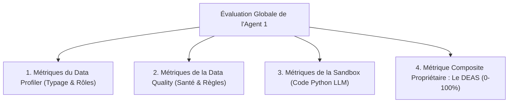

# 📐 Cadre d'Évaluation Rigoureux : Data Engineering Agent (Agent 1)
> **Auteur :** Spécialiste Data Engineering (Agent 1)  
> **Projet :** BIFlow — Plateforme Multi-Agents Autonome  
> **Objectif :** Formaliser les métriques d'évaluation du *Data Profiler*, de la *Data Quality*, de la *Sandbox* et présenter la métrique propriétaire **DEAS**.

---

## 1. Vue d'Ensemble du Cadre d'Évaluation

Pour évaluer scientifiquement le **Data Engineering Agent**, l'évaluation est découpée en **4 axes complémentaires** :



---

## 2. Axe 1 : Métriques du Data Profiler ([`analytics/profiler.py`](../analytics/profiler.py))

Le Data Profiler a pour tâche de classifier les rôles sémantiques des colonnes (`identifier`, `numeric_metric`, `categorical_dimension`, `datetime`) et de calculer les cardinalités.

### Métriques Clés :

#### A. Précision, Rappel et F1-Score sur l'Inférence des Rôles
Sur un jeu de test étiqueté (Ground Truth de 50 colonnes connues) :
$$F1_{\text{rôles}} = 2 \times \frac{\text{Précision} \times \text{Rappel}}{\text{Précision} + \text{Rappel}}$$
- **True Positive (TP)** : Colonne ID identifiée correctement comme `identifier`.
- **False Positive (FP)** : Colonne catégorielle à haute cardinalité classée à tort comme `identifier`.
- **False Negative (FN)** : Date non reconnue et laissée en `categorical_dimension`.

#### B. Taux de Détection des Fausses Chaînes Numériques (*Dirty Numeric Strings*)
Mesure la capacité du profiler à repérer les colonnes numériques polluées par des symboles de devises (`$`, `€`), des virgules ou des espaces :
$$\text{Taux Détection} = \frac{\text{Colonnes sales identifiées par regex}}{\text{Total réel de colonnes sales du dataset}}$$
*Objectif visé dans BIFlow : 100% de détection grâce au ratio seuil de 80% (ligne 106 de `data_quality.py`).*

---

## 3. Axe 2 : Métriques de la Data Quality ([`analytics/data_quality.py`](../analytics/data_quality.py))

La qualité est évaluée selon les **4 dimensions internationales de la gouvernance de données (DAMA-DMBOK)** :

### A. Complétude (*Completeness*)
Mesure la détection exhaustive des valeurs manquantes, y compris les valeurs sentinelles masquées (`"?"`, `"N/A"`, `"null"`, espaces vides) :
$$\text{Complétude} = \left( 1 - \frac{\text{Cellules Manquantes Détectées}}{\text{Nombre Total de Cellules}} \right) \times 100$$

### B. Validité des Types (*Type Validity*)
$$\text{Validité} = \frac{\text{Lignes conformes au type attendu}}{\text{Nombre total de lignes}}$$

### C. Cohérence Logique Croisée (*Cross-Column Consistency*)
Mesure la détection des incohérences logiques impossibles entre colonnes dépendantes :
- *Exemple :* `tenure == 0` mais `TotalCharges > 0`.
- *Exemple :* `Date_Fin < Date_Debut`.
- *Métrique :* **Nombre de violations croisées identifiées / Total de violations réelles**.

### D. Le Gain Net de Santé ($\Delta \text{HealthScore}$)
$$\Delta Q = \text{HealthScore}_{\text{après nettoyage}} - \text{HealthScore}_{\text{avant nettoyage}}$$
*Exemple : Un dataset passe de 62% à 96%, soit un gain net de +34 points de qualité.*

---

## 4. Axe 3 : Métriques de Robustesse de la Sandbox

Évalue la qualité du code Python généré par le LLM pour les vérifications sur mesure (`needs_custom_check`) exécutées dans notre sandbox isolée :

| Métrique | Formule | Seuil Cible |
| :--- | :--- | :---: |
| **Pass Rate (Taux de succès d'exécution)** | $\frac{N_{\text{fonctions sans erreur}}}{N_{\text{fonctions générées}}} \times 100$ | **> 95%** |
| **Syntax Error Rate** | $\frac{N_{\text{SyntaxError}}}{N_{\text{fonctions générées}}} \times 100$ | **< 3%** |
| **Timeout Interception Rate** | $\frac{N_{\text{boucles coupées à 8s}}}{N_{\text{fonctions générées}}} \times 100$ | **0%** |
| **Temps Moyen d'Exécution Sandbox** | Moyenne de la durée d'évaluation par colonne | **< 5 ms** |

---

## 5. Axe 4 : La Métrique Composite Propriétaire — **Le DEAS**

Pour donner une note unique, scientifique et reproductible à l'agent de bout en bout, nous avons conçu le **DEAS (`Data Engineering Agent Score`)** :

$$\mathbf{DEAS} = (0.15 \cdot S_{\text{format}}) + (0.30 \cdot S_{\text{diagnostic}}) + (0.25 \cdot S_{\text{sandbox}}) + (0.30 \cdot S_{\text{nettoyage}})$$

```python
# Script de calcul officiel de DEAS
def calculate_deas(format_score: float, diagnostic_f1: float, sandbox_pass_rate: float, health_gain_ratio: float) -> float:
    """
    Calcule le Data Engineering Agent Score normalisé de 0% à 100%.
    """
    w1, w2, w3, w4 = 0.15, 0.30, 0.25, 0.30
    deas = (w1 * format_score) + (w2 * diagnostic_f1) + (w3 * sandbox_pass_rate) + (w4 * health_gain_ratio)
    return round(deas * 100, 2)
```

---

## 6. L'Évaluation Qualitative par *LLM-as-a-Judge* (G-Eval)

Pour évaluer la pertinence métier du texte de raisonnement produit par l'Agent 1 (`agent_reasoning` et `agent_summary`), nous utilisons un LLM Juge (ex: Gemini Flash ou GPT-4o) avec cette grille d'évaluation notée de 1 à 5 :

```text
Grille d'Évaluation LLM-as-a-Judge (Rubric) :
1. Pertinence Causale (1 à 5) : L'agent identifie-t-il la véritable cause sous-jacente du problème ?
2. Adéquation de l'Imputation (1 à 5) : La méthode choisie (médiane, moyenne, mode) respecte-t-elle la distribution ?
3. Concision et Clarté (1 à 5) : Le résumé exécutif est-il synthétique et directement exploitable par l'ingénieur ?
```

---

## 7. Discours Synthétique pour la Soutenance

> « Madame / Monsieur, nous ne nous sommes pas contentés d'évaluer notre agent de manière empirique. Nous avons établi un protocole d'évaluation scientifique à 4 niveaux :
> 
> 1. **Au niveau Profiling & Qualité :** Nous mesurons le F1-Score sur la détection des types, le taux de couverture des valeurs manquantes masquées et la conformité aux 4 dimensions DAMA (Complétude, Validité, Unicité, Cohérence croisée).
> 2. **Au niveau de la Sandbox :** Nous mesurons le taux d'exécution sans erreur (`Pass Rate > 95%`) et l'absence de timeout sur le code généré.
> 3. **Au niveau Global :** Nous avons formalisé notre propre métrique composite normalisée, le **DEAS (`Data Engineering Agent Score`)**, qui pondère la rigueur du format JSON (15%), l'exactitude du diagnostic (30%), la robustesse du code sandbox (25%) et le gain net de santé des données (30%).
> 
> Ce cadre nous permet de prouver mathématiquement la supériorité de notre agent autonome par rapport à des règles statiques manuelles. »
