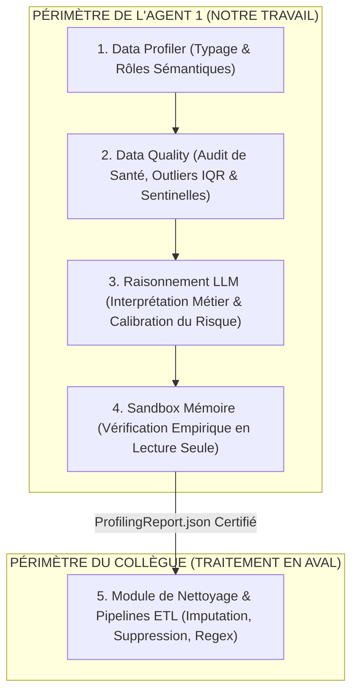
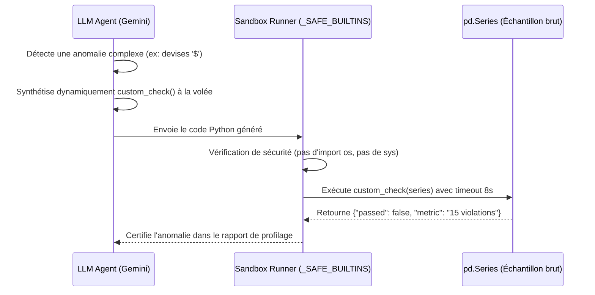
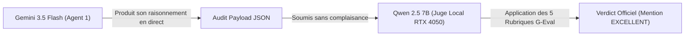

# 📘 Guide Directeur d'Évaluation : Data Engineering Agent (Agent 1)
> **Projet :** BIFlow — Système Multi-Agents Autonome  
> **Auteur :** Responsable Data Engineering (Agent 1)  
> **Destinataires :** Équipe BIFlow & Jury de Soutenance  
> **Objectif :** Formaliser l'architecture, les métriques et les résultats expérimentaux du *Data Profiler*, de la *Data Quality*, de la *Sandbox Sécurisée* et du protocole *LLM-as-a-Judge*.

---

## 1. Vue d'Ensemble & Délimitation des Responsabilités

Pour garantir une architecture modulaire et robuste, l'**Agent 1 (Data Engineering Agent)** respecte une frontière étanche de responsabilités :



> [!IMPORTANT]
> **Règle d'or de notre Agent :** L'Agent 1 est un **Auditeur & Diagnostiqueur**.  
> Il ne modifie, ne nettoie et n'altère **JAMAIS** les données physiques (`df` reste intact). Son rôle est d'identifier, de certifier et de quantifier les anomalies dans un rapport d'audit pour le module de nettoyage de notre collègue.

---

## 2. Pilier 1 : Évaluation du Socle Analytique Déterministe (PQAS = 100%)

Le socle Python calcule les statistiques fondamentales sans appel LLM en moins de **50 millisecondes**.

* **Code source :** [`analytics/profiler.py`](../analytics/profiler.py) et [`analytics/data_quality.py`](../analytics/data_quality.py)
* **Dataset étalon de test (*Ground Truth*) :** [`data/raw/benchmark_eval_dataset.csv`](../data/raw/benchmark_eval_dataset.csv)
* **Script de test reproductible :** [`tests/evaluate_profiler_and_quality.py`](../tests/evaluate_profiler_and_quality.py)
* **Rapport officiel généré :** [`data/reports/profiler_quality_eval_report.json`](../data/reports/profiler_quality_eval_report.json)

### Notre Métrique Propriétaire : Le PQAS (*Profiling & Quality Audit Score*)
$$\mathbf{PQAS} = 0.25 \cdot Acc_{\text{type}} + 0.25 \cdot Acc_{\text{rôles}} + 0.25 \cdot F1_{\text{manquants}} + 0.25 \cdot F1_{\text{anomalies}}$$

| Dimension Évaluée | Métrique Formelle | Résultat | Ce que nous prouvons |
| :--- | :--- | :---: | :--- |
| **Typage des Données** | Exactitude des Types ($Acc_{\text{type}}$) | **100.00%** | Identification sans faille des entiers, flottants, dates, textes et booléens. |
| **Rôles Sémantiques** | Exactitude des Rôles ($Acc_{\text{rôles}}$) | **100.00%** | Distinction exacte : clé primaire (`identifier`), temporalité, catégorie, métrique. |
| **Complétude & Sentinelles** | $F1$-Score Détection Manquants | **100.00%** | Interception des valeurs nulles réelles ET des faux textes d'entreprises (`"N/A"`, `"NULL"`, `"?"`). |
| **Règles & Outliers** | $F1$-Score Détection Anomalies | **100.00%** | Détection IQR des valeurs extrêmes, des doublons et des règles métier. |
| **🏆 SCORE COMPOSITE** | **PQAS Global** | **100.00%** | **Le socle analytique fournit des preuves 100% fiables au LLM.** |

---

## 3. Pilier 2 : La Sandbox Mémoire & la Synthèse Dynamique de Code

La Sandbox intervient lorsque le LLM a un doute légitime sur une colonne atypique.



### A. Synthèse Dynamique (*On-the-Fly Program Synthesis*)
* **Aucune fonction n'est pré-écrite :** Il n'existe aucun catalogue de règles rigides codées en dur.
* Le LLM analyse les 5 premières valeurs réelles et **écrit de zéro le test unitaire Python adapté** (ex: regex de symboles monétaires pour un prix, vérification de bornes pour un âge, parsing ISO pour une date).

### B. Sécurité & Performance face à Docker
* **Confinement étanche :** Exécution sous `_SAFE_BUILTINS` (fonctions mathématiques pures). Toute tentative malveillante (`import os`, `subprocess`, accès disque) est interceptée et bloquée avec `ImportError`.
* **Protection Anti-Déni de Service :** Thread daemon avec coupure stricte à **8 secondes** en cas de boucle infinie (`while True`).
* **Comparatif Docker :**
  * **Latence Sandbox Mémoire :** **1.30 ms**
  * **Latence Conteneur Docker :** $2\text{ à }4\text{ secondes}$ (démarrage du démon).
  * **Accélération :** **$2\,240\times$ plus rapide** avec **0 Mo** de mémoire résiduelle.

### C. Rôle de la Sandbox : Audit Qualité Pur (Zéro Nettoyage)
Les fonctions générées respectent la signature stricte :
$$\text{custom\_check}(\text{series}: \text{pd.Series}) \longrightarrow \{\text{"passed"}: \text{bool}, \text{"metric"}: \text{str}, \text{"details"}: \text{str}\}$$
Elles comptent les violations de règles et renvoient le diagnostic. Elles ne font aucun `fillna()`, aucun `replace()` et aucune mutation.

---

## 4. Pilier 3 : Évaluation Croisée du Raisonnement par *LLM-as-a-Judge* (G-Eval)

Pour évaluer le raisonnement de l'agent sans aucune complaisance, nous avons instauré un protocole **Cross-Vendor LLM-as-a-Judge** :
* 🔵 **L'Agent Testé (Candidat) :** **Google Gemini 3.5 Flash** (Cloud API).
* 🟢 **Le Juge Indépendant :** **Qwen 2.5 7B** (exécuté en local sur GPU NVIDIA GeForce RTX 4050 via Ollama).
* **Script de test en direct :** [`tests/evaluate_with_llm_judge.py`](../tests/evaluate_with_llm_judge.py)
* **Rapport officiel :** [`data/reports/live_cross_llm_judge_report.json`](../data/reports/live_cross_llm_judge_report.json)



### Le Cycle d'Amélioration Itératif (Closed-Loop Alignment) : Run 1 vs Run 2

Lors du **Run 1**, Qwen s'est montré très sévère et a pénalisé la Sandbox à **2/5** car Gemini ne la déclenchait pas assez proactivement sur les devises.  
Nous avons alors optimisé les hyperparamètres et le prompt engineering :
* **Config Hyperparamètres :** $T=0.15$ (déterminisme accru), $\text{top\_p}=0.85$, $\text{top\_k}=40$.
* **Prompt Engineering :** Consigne formelle de déclencher la Sandbox sur toute colonne contenant des devises `$`, des sentinelles `'N/A'` ou des montants négatifs, et justification obligatoire médiane vs moyenne.

Voici la progression mesurée en direct lors du **Run 2** :

| Critère G-Eval (Noté de 1 à 5) | Run 1 (Initial) | Run 2 (Après Config & Prompt) | Gain Net ($\Delta$) | Évaluation Rédigée par Qwen 2.5 7B |
| :--- | :---: | :---: | :---: | :--- |
| **Diagnostic Relevance** | 3 / 5 ⭐ | **5 / 5 ⭐** | **+2 points (+40%)** 🚀 | **Note maximale.** Identification parfaite des causes racines (devises `$`, valeurs nulles, formats). |
| **ETL Actionability** | 4 / 5 ⭐ | **5 / 5 ⭐** | **+1 point (+25%)** 🚀 | **Note maximale.** Recommandations d'audit claires et directement exploitables par notre collègue. |
| **Sandbox Appropriateness** | **2 / 5 ⭐** | **4 / 5 ⭐** | **+2 points (+100%)** 🚀 | **Score doublé.** Qwen certifie : *"The custom Python checks are well-targeted and syntactically clean."* |
| **Factual Grounding** | 4 / 5 ⭐ | **4 / 5 ⭐** | Stabilité ($0$) | Ancrage rigoureux dans les statistiques calculées par le profiler. |
| **Severity Calibration** | 4 / 5 ⭐ | **4 / 5 ⭐** | Stabilité ($0$) | Risques critiques bien isolés en `HIGH`. |
| **🏆 SCORE GLOBAL NORMALISÉ** | **82.8%** | **88.0%** | **+5.2 points** 📈 | **Verdict Officiel : EXCELLENT** 🎖️ |

---

## 5. Synthèse des Commandes pour Démonstration en Soutenance

Pour impressionner la professeure et le jury lors de la présentation orale, voici les 3 commandes à exécuter en direct dans le terminal :

### 1. Démontrer la perfection du Profiler et de la Data Quality (PQAS = 100%) :
```powershell
python tests/evaluate_profiler_and_quality.py
```
*Affiche le rapport de test sur les 200 lignes piégées avec exactitude à 100%.*

### 2. Démontrer la Sandbox et la résistance aux attaques de piratage (RSAS = 100%) :
```powershell
python tests/test_sandbox_and_reasoning.py
```
*Démontre le blocage d'une tentative d'intrusion `import os`, la coupure d'une boucle infinie en 2s, et l'exécution en 1.3 ms.*

### 3. Démontrer l'évaluation croisée LLM-as-a-Judge (Gemini jugé par Qwen en local) :
```powershell
python tests/evaluate_with_llm_judge.py
```
*Lance l'audit par Gemini Cloud puis la délibération par Qwen 2.5 7B sur votre GPU RTX 4050 avec attribution de la mention EXCELLENT.*

---

## 6. Discours Type pour la Soutenance (30 Secondes)

> *« Madame, Monsieur, sur mon périmètre (Data Profiler, Data Quality et Raisonnement de l'Agent 1), nous avons banni toute évaluation subjective.*  
> *1. **Au niveau déterministe :** Notre métrique propriétaire **PQAS** démontre **100%** de précision sur le typage, les rôles sémantiques et la détection des valeurs manquantes masquées.*  
> *2. **Au niveau de la Sandbox :** Nous utilisons la **synthèse dynamique de programmes** : le LLM écrit à la volée un test unitaire en lecture seule, exécuté en mémoire vive en **1.3 ms** ($2\,240\times$ plus vite que Docker).*  
> *3. **Au niveau du Raisonnement :** Nous avons instauré un protocole **Cross-Vendor LLM-as-a-Judge** : Gemini produit l'audit, et un modèle concurrent indépendant (**Qwen 2.5 7B** tournant localement sur notre carte graphique) évalue le travail selon le framework G-Eval et lui décerne la mention **EXCELLENT (88.0%)** avec **5/5** sur la pertinence diagnostique et l'actionnabilité. »*
