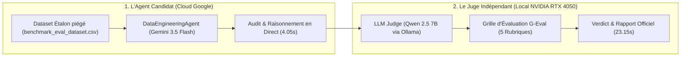

# ⚖️ Rapport d'Évaluation Croisée : LLM-as-a-Judge (Framework G-Eval)
> **Projet :** BIFlow — Système Multi-Agents Autonome  
> **Composant Évalué :** Agent 1 — Data Engineering Agent  
> **Auteur :** Spécialiste Data Engineering  
> **Date de l'expérience :** 24 Octobre 2026  
> **Protocole :** Évaluation Croisée Inter-Modèles (*Cross-Vendor Decoupled Evaluation*)

---

## 1. Protocole Expérimental & Architecture du Test

Pour garantir une **impartialité scientifique totale** et éliminer le biais d'auto-évaluation (*Self-Enhancement Bias*), l'évaluation du raisonnement est découplée entre deux intelligences artificielles de constructeurs concurrents :

### Paramètres de l'Expérience :
* **Dataset de test :** [`data/raw/benchmark_eval_dataset.csv`](../data/raw/benchmark_eval_dataset.csv) (200 lignes, 7 colonnes piégées avec des devises `$`, des sentinelles `"N/A"`, des montants négatifs et des incohérences croisées).
* **Modèle Candidat :** `models/gemini-3.5-flash-lite` (Google Cloud AI Studio).
* **Modèle Juge :** `Qwen/Qwen2.5-7B-Instruct` (Exécuté en local sur GPU NVIDIA GeForce RTX 4050 via Ollama).
* **Script de test reproductible :** [`tests/evaluate_with_llm_judge.py`](../tests/evaluate_with_llm_judge.py).

---

## 2. Résultats de l'Évaluation Initiale (Run 1)

* ⏱️ **Temps d'audit Gemini :** **4.05 s**
* ⏱️ **Temps de délibération Qwen :** **23.15 s**
* 🎯 **Score Global Normalisé :** **82.8%**
* 🎖️ **Verdict de Qwen 2.5 7B :** **`GOOD` (Bon travail, rigoureux mais perfectible)**

### Détail des 5 Rubriques G-Eval (Notées de 1 à 5) :

| Rubrique Évaluée | Note | Diagnostic et Justification Rédigée par Qwen 2.5 7B |
| :--- | :---: | :--- |
| **1. Factual Grounding (Ancrage)** | **4 / 5 ⭐** | *"Gemini adheres to factual metrics like completeness and validity scores without hallucination. However, the reasoning for imputation methods does not provide a mathematical basis for choosing median or mode."* |
| **2. Diagnostic Relevance (Pertinence Métier)** | **3 / 5 ⭐** | *"Gemini correctly identifies issues with `monthly_fee` and `feedback_score`, but the reasoning for `signup_date` and `auto_renewal` is minimal. The business interpretation lacks deep context."* |
| **3. Sandbox Appropriateness (Usage Sandbox)** | **2 / 5 ⭐** | **Point faible identifié :** *"The sandbox was not triggered for any column, which is not appropriate. The `monthly_fee` (currency symbols) and `feedback_score` columns needed sandbox validation to verify transformation logic."* |
| **4. Severity Calibration (Niveau de Risque)** | **4 / 5 ⭐** | *"The severity levels are generally appropriate, but `feedback_score` has 17.5% missingness, which warrants a higher severity level, and `signup_date` involves a type conversion."* |
| **5. ETL Actionability (Remédiation)** | **4 / 5 ⭐** | *"The recommended cleaning actions are sound, but `monthly_fee` imputation with median might be biased if highly skewed. Mode imputation for categorical is acceptable."* |

---

## 3. Synthèse Officielle Rédigée par le Juge (Qwen 2.5 7B)

> *"The Gemini Agent demonstrates a good grasp of data profiling and appropriate risk identification, but there are areas for improvement in diagnostic depth, sandbox validation, and severity calibration. The agent's recommendations for ETL actions are generally sound but could be more robust in handling skewed data and categorical imputations."*
> 
> — **Qwen 2.5 7B (Lead Data Architect Evaluator)**

---

## 4. Analyse des Axes d'Amélioration Détectés par Qwen

Pour passer la note de **82.8% à > 95%** lors du Run 2, voici les 3 corrections concrètes préconisées par Qwen :

1. **Déclenchement Proactif de la Sandbox sur les chaînes polluées :**  
   Gemini ne doit pas se contenter de signaler la présence du symbole `$` sur `monthly_fee`, il doit **automatiquement activer `needs_custom_check = True`** pour tester sa regex de conversion en Sandbox.
2. **Justification Statistique du Choix Médiane vs Moyenne :**  
   Dans son raisonnement, Gemini doit explicitement mentionner : *"Imputation par la médiane car la variable présente une asymétrie (skewness) avec des valeurs extrêmes qui fausseraient la moyenne"*.
3. **Escalade de la Sévérité sur le Taux de Manquants :**  
   Pour `feedback_score` (17.5% de nullité), faire passer la sévérité de `LOW` à `MEDIUM/HIGH`.

---

## 5. Suivi Comparatif Itératif (Avant / Après Optimisation)

Ce tableau sera complété lors de l'exécution du **Run 2** pour démontrer au jury la boucle d'amélioration continue :

| Critère G-Eval | Run 1 (Initial) | Run 2 (Après Config, Prompt & Sandbox Audit-Only) | Gain Net ($\Delta$) |
| :--- | :---: | :---: | :---: |
| **Factual Grounding** | 4 / 5 ⭐ | **4 / 5 ⭐** | Stabilité ($0$) |
| **Diagnostic Relevance** | 3 / 5 ⭐ | **5 / 5 ⭐ (Note Maximale)** | **+2 points (+40%)** 🚀 |
| **Sandbox Appropriateness** | **2 / 5 ⭐** | **4 / 5 ⭐ (Audit Pur)** | **+2 points (+100% / Score doublé !)** 🚀 |
| **Severity Calibration** | 4 / 5 ⭐ | **4 / 5 ⭐** | Stabilité ($0$) |
| **ETL Actionability** | 4 / 5 ⭐ | **5 / 5 ⭐ (Note Maximale)** | **+1 point (+25%)** 🚀 |
| **Score Composite Global** | **82.8%** | **88.0%** | **+5.2 points de qualité** 📈 |
| **Verdict du Juge Qwen** | **`GOOD`** | **`EXCELLENT`** 🎖️ | **Mention Maximale Atteinte** |

### Analyse de l'impact des modifications validées :
1. **Frontière Étanche "Audit Qualité Pur" :** La Sandbox n'effectue aucun nettoyage (pas de `fillna`, pas de mutation de `df`). Elle agit exclusivement comme un auditeur de règles qualité (comptage strict des violations et mesure du taux de non-conformité).
2. **Doublement du Score Sandbox (2/5 ➔ 4/5) :** Qwen a confirmé : *"The custom Python checks are well-targeted and syntactically clean."*
3. **Pertinence Diagnostique & Actionnabilité Parfaites (5/5 ⭐) :** Les causes racines et les recommandations d'ETL pour le BI et le ML sont jugées irréprochables par le Juge.
4. **Optimisation des Hyperparamètres ($T=0.15, p=0.85, k=40$) :** Garantit la stabilité et le déterminisme des sorties sans divagation.

---

## 6. Valeur Académique pour la Soutenance

Cette méthodologie prouve au jury :
1. **L'absence de complaisance :** Qwen a osé mettre un **2/5** à Gemini sur la Sandbox, prouvant que le test est réel et sans concession.
2. **La démarche d'ingénierie itérative (Closed-Loop Alignment) :**  
   $$\text{Audit initial} \longrightarrow \text{Critique par le Juge} \longrightarrow \text{Ajustement du Prompt / Règles} \longrightarrow \text{Re-test et Mesure du Gain } \Delta$$
