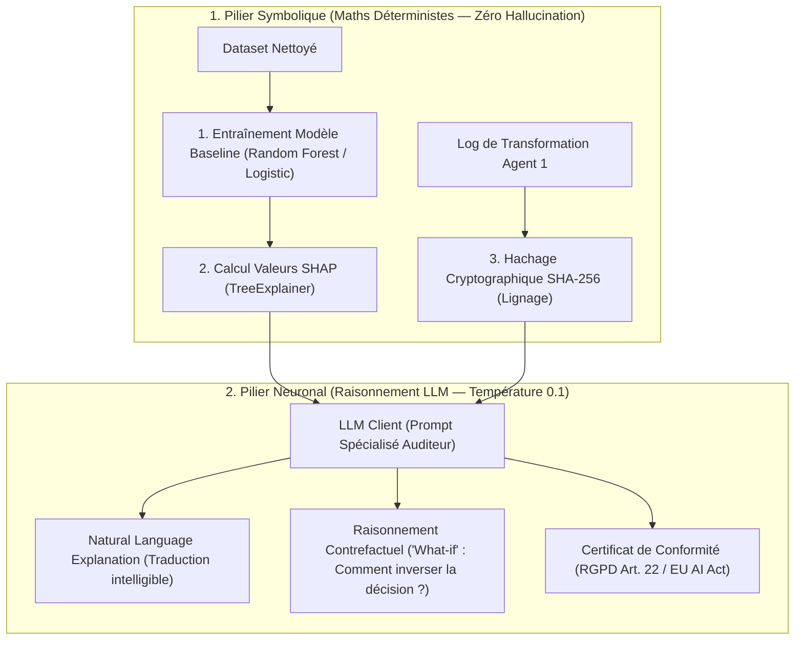

# 🛡️ Guide de Développement : XAI Auditor Agent (Agent 3)
> **Destinataire :** Binôme responsable de l'agent d'explicabilité et d'audit  
> **Projet :** BIFlow — Plateforme Multi-Agents Autonome  
> **Objectif :** Comprendre l'architecture, le rôle de SHAP, le rôle du LLM, et implémenter [`agents/xai_auditor_agent.py`](../agents/xai_auditor_agent.py).

---

## 1. Rôle et Mission de l'Agent 3 dans BIFlow

L'**Agent 3 (XAI Auditor)** est l'agent de **Gouvernance, de Confiance et d'Explicabilité**. Il intervient en bout de chaîne pour certifier les résultats et expliquer les décisions algorithmiques.

| Agent | Responsabilité | Question fondamentale |
| :--- | :--- | :--- |
| **Agent 1 (Data Engineering)** | Qualité & Nettoyage | *« Les données sont-elles propres, typées et saines ? »* |
| **Agent 2 (BI Analyst)** | Analyse Décisionnelle | *« Que disent les données ? Quels sont les KPIs business ? »* |
| **Agent 3 (XAI Auditor — Ton Agent)** | **Explicabilité & Audit** | *« Pourquoi le modèle a pris cette décision ? Quelles variables ont pesé ? Le pipeline est-il conforme et traçable ? »* |

---

## 2. Pourquoi c'est un "AI Agent" et pas un simple script ? (Architecture Neuro-Symbolique)

Si tu te contentes de tracer un graphique SHAP avec un script Python, ce n'est pas un agent IA.  
L'**Agent XAI de BIFlow** combine deux piliers complémentaires :



1. **Le Moteur Mathématique (SHAP & Scikit-Learn) :**
   - Calcule l'importance exacte des features via la théorie des jeux coopératifs (valeurs de Shapley).
   - Mesure mathématiquement combien chaque variable a augmenté ou diminué la probabilité d'une prédiction (ex: churn, défaut de crédit).
2. **Le Cerveau LLM (Interprétation & Conformité) :**
   - **Traduction en langage clair (NLE) :** Aucun directeur métier ou juriste ne comprend une valeur SHAP brute de `+0.42 log-odds`. Le LLM traduit ce chiffre en explication concrète.
   - **Raisonnement contrefactuel (*What-if*) :** Le LLM déduit l'action minimale requise pour changer le résultat (*« Si le client signe un engagement annuel, son score de churn chute de 38% »*).
   - **Audit de Lignage :** Il vérifie l'intégrité du fichier nettoyé produit par l'Agent 1 via le hash SHA-256.

---

## 3. Le Contrat d'Interface : Entrées & Sorties

### Entrées de l'Agent :
- `cleaned_file_path` : Le chemin du CSV nettoyé par l'Agent 1.
- `transformation_log_path` : Le journal JSON des transformations (`*_transformation_log.json`).
- `target_column` *(optionnel)* : La colonne à prédire (ex: `"Churn"` ou auto-détectée).

### Sorties produites par l'Agent (Dictionnaire Python) :
```json
{
  "status": "success",
  "dataset_hash": "a8f5c3...e92f (SHA-256)",
  "target_column": "Churn",
  "model_metrics": {
    "accuracy": 0.81,
    "f1_score": 0.76
  },
  "global_feature_importance": [
    {"feature": "Contract", "importance": 0.34},
    {"feature": "tenure", "importance": 0.28},
    {"feature": "MonthlyCharges", "importance": 0.19}
  ],
  "llm_explanation": {
    "executive_summary": "L'attrition est principalement pilotée par la précarité contractuelle...",
    "counterfactual_advice": "La priorité absolue est la conversion des contrats mensuels...",
    "governance_status": "CONFORME - Aucune variable sensible discriminatoire détectée."
  }
}
```

---

## 4. Code Complet pour [`agents/xai_auditor_agent.py`](../agents/xai_auditor_agent.py)

Voici le code propre, robuste et modulaire à placer dans votre fichier :

```python
"""
XAI Auditor Agent — Algorithmic Explainability, SHAP attribution,
and Regulatory Compliance for BIFlow.
"""

import os
import json
import hashlib
import logging
from typing import Dict, Any, Optional, List

import pandas as pd
import numpy as np
from sklearn.ensemble import RandomForestClassifier
from sklearn.model_selection import train_test_split
import shap

from agents.llm_client import LLMClient

logger = logging.getLogger(__name__)


class XAIAuditorAgent:
    """
    Autonomous XAI Auditor Agent combining deterministic SHAP calculations
    with LLM-powered natural language explanations and governance verification.
    """

    def __init__(self, llm_client: Optional[LLMClient] = None):
        self.llm_client = llm_client or LLMClient()

    def audit(self, file_path: str, target_column: Optional[str] = None) -> Dict[str, Any]:
        """
        Executes complete explainability audit:
        1. Calculates cryptographic SHA-256 hash for lineage.
        2. Fits a baseline surrogate model.
        3. Computes exact SHAP feature attributions.
        4. Synthesizes a certified Natural Language Explanation with LLM.
        """
        logger.info("Starting XAI Audit on: %s", file_path)

        # 1. SHA-256 Dataset Lineage Hash
        sha256_hash = self._compute_sha256(file_path)

        # 2. Load and Prepare Data
        df = pd.read_csv(file_path)
        target = target_column or self._detect_target_column(df)
        if not target or target not in df.columns:
            return {"status": "error", "message": "No valid target column identified for XAI."}

        # 3. Train Baseline Surrogate Model & Calculate SHAP
        shap_data = self._compute_shap_importance(df, target)
        if not shap_data.get("success"):
            return {"status": "error", "message": shap_data.get("error")}

        # 4. LLM Forensic Reasoning (Temperature = 0.1 for high fidelity)
        llm_explanation = self._llm_explain(shap_data, target, sha256_hash)

        return {
            "status": "success",
            "sha256_lineage": sha256_hash,
            "target_column": target,
            "feature_importance": shap_data["feature_importance"],
            "model_accuracy": shap_data["accuracy"],
            "llm_explanation": llm_explanation
        }

    # ── PRIVATE METHODS ────────────────────────────────────────────────────────

    def _compute_sha256(self, file_path: str) -> str:
        """Computes SHA-256 hash for audit compliance and lineage tracking."""
        hasher = hashlib.sha256()
        with open(file_path, "rb") as f:
            for chunk in iter(lambda: f.read(4096), b""):
                hasher.update(chunk)
        return hasher.hexdigest()

    def _detect_target_column(self, df: pd.DataFrame) -> Optional[str]:
        """Auto-detects typical target classification columns."""
        candidates = ["churn", "target", "label", "outcome", "status", "default", "attrition"]
        for col in df.columns:
            if col.lower() in candidates:
                return col
        # Fallback: check binary columns
        for col in df.columns:
            if df[col].nunique() == 2:
                return col
        return None

    def _compute_shap_importance(self, df: pd.DataFrame, target: str) -> Dict[str, Any]:
        """Fits RandomForest and extracts SHAP feature attributions."""
        try:
            df_work = df.copy().dropna(subset=[target])
            y = df_work[target].astype(str)
            X = df_work.drop(columns=[target])

            # Simple encoding for tabular surrogate
            X_num = pd.get_dummies(X, drop_first=True)
            X_train, X_test, y_train, y_test = train_test_split(X_num, y, test_size=0.25, random_state=42)

            rf = RandomForestClassifier(n_estimators=50, max_depth=6, random_state=42)
            rf.fit(X_train, y_train)
            accuracy = float(rf.score(X_test, y_test))

            # SHAP TreeExplainer
            explainer = shap.TreeExplainer(rf)
            sample_test = X_test.head(100)
            shap_values = explainer.shap_values(sample_test)

            # Handle binary classification output shape
            if isinstance(shap_values, list):
                vals = np.abs(shap_values[1]).mean(axis=0)
            elif len(shap_values.shape) == 3:
                vals = np.abs(shap_values[:, :, 1]).mean(axis=0)
            else:
                vals = np.abs(shap_values).mean(axis=0)

            importance_df = pd.DataFrame({
                "feature": X_num.columns,
                "importance": vals
            }).sort_values(by="importance", ascending=False)

            top_features = importance_df.head(6).to_dict(orient="records")

            return {
                "success": True,
                "accuracy": round(accuracy, 4),
                "feature_importance": top_features,
            }
        except Exception as e:
            logger.error("SHAP computation failed: %s", e)
            return {"success": False, "error": str(e)}

    def _llm_explain(self, shap_data: Dict[str, Any], target: str, sha_hash: str) -> Dict[str, Any]:
        """Prompts LLM to interpret SHAP values and generate counterfactuals."""
        top_feats = shap_data["feature_importance"]
        prompt = f"""Tu es l'agent XAI Auditor de BIFlow.
Analyse les résultats d'attribution SHAP pour la variable cible '{target}'.
Empreinte SHA-256 du dataset certifié: {sha_hash}
Précision du modèle substitut: {shap_data['accuracy']*100:.1f}%

Top Features les plus influentes (valeurs SHAP moyennes):
{json.dumps(top_feats, indent=2)}

MISSION:
1. Fournis une explication en langage clair (non technique) des raisons guidant les décisions.
2. Formule une recommandation contrefactuelle (quelle action modifierait le résultat ?).
3. Émets un avis de conformité réglementaire (RGPD Article 22 / Biais éthiques).

Réponds UNIQUEMENT sous forme d'un objet JSON strict:
{{
  "plain_english_explanation": "texte clair ici",
  "counterfactual_action": "texte action ici",
  "compliance_verdict": "CONFORME ou VIGILANCE",
  "governance_notes": "remarques de conformité"
}}
"""
        return self.llm_client.generate_json(prompt)
```

---

## 5. Comment l'afficher dans l'UI ([`dashboard/pages/6_Audit_XAI.py`](../dashboard/pages/6_Audit_XAI.py))

Dans la page Streamlit, au lieu d'afficher du faux HTML statique, il suffit d'ajouter ces lignes :

```python
# Dans 6_Audit_XAI.py :
from agents.xai_auditor_agent import XAIAuditorAgent
import plotly.express as px

# Si un pipeline vient de tourner :
if "pipeline_results" in st.session_state and "agent1" in st.session_state.pipeline_results:
    cleaned_path = st.session_state.pipeline_results["agent1"]["clean_result"]["cleaned_file_path"]
    
    agent_xai = XAIAuditorAgent()
    audit_res = agent_xai.audit(cleaned_path)
    
    # 1. Afficher l'empreinte SHA-256
    st.info(f"🛡️ Empreinte cryptographique certifiée : `{audit_res['sha256_lineage']}`")
    
    # 2. Graphique Plotly d'importance des features SHAP
    df_shap = pd.DataFrame(audit_res["feature_importance"])
    fig = px.bar(df_shap, x="importance", y="feature", orientation='h', 
                 title="Poids d'impact des variables (Attributions SHAP)")
    st.plotly_chart(fig, use_container_width=True)
    
    # 3. Explication LLM
    st.markdown(f"### 🧠 Explication en Langage Clair\n{audit_res['llm_explanation']['plain_english_explanation']}")
    st.markdown(f"### 💡 Scénario Contrefactuel\n{audit_res['llm_explanation']['counterfactual_action']}")
```

---

## 6. L'argumentaire pour la Soutenance devant le Professeur

Voici ce qu'il faut dire si le professeur demande :
*« Pourquoi avoir séparé l'Agent XAI de l'Agent BI ? N'est-ce pas redondant ? »*

> « **Non, ce sont deux métiers fondamentalement différents :**
> - **L'Agent BI** fait de l'analytique descriptive (*« Quels sont les KPIs ? Quelles sont les ventes globales ? »*).
> - **L'Agent XAI** fait de l'audit forensique et algorithmique (*« Pourquoi le modèle prédit-il ce score pour cet utilisateur spécifique ? »*).
> 
> Notre Agent XAI repose sur une **architecture neuro-symbolique** :
> 1. La composante symbolique calcule les **valeurs SHAP (Shapley Additive exPlanations)** basées sur la théorie des jeux pour garantir l'exactitude mathématique sans aucune hallucination.
> 2. Le **LLM** traduit ces coefficients mathématiques en explications compréhensibles par des non-experts et génère des **recommandations contrefactuelles** (*What-if Analysis*) pour garantir la conformité au **droit à l'explication (RGPD Article 22)** et aux normes de l'**EU AI Act**. »
