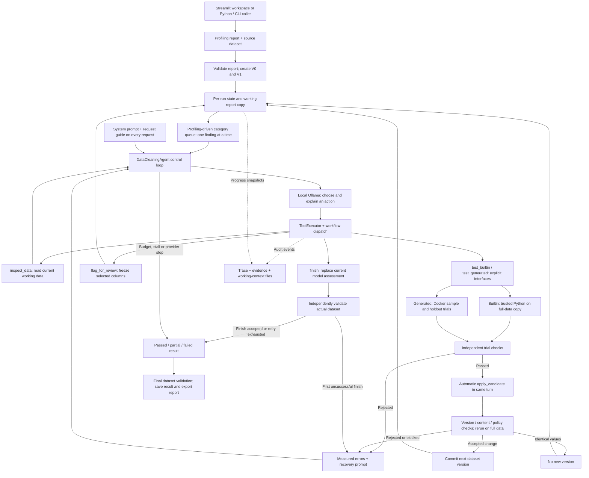

# Current Data Cleaning & ETL Agent architecture

This describes the implemented code as of 1 November 2026. Agent 2 is a Python-controlled tool-calling loop using local Ollama, with optional Groq fallback code generation. The local model writes initial repairs; Groq can author a fallback after four failed local corrections; Python controls execution, validation, version commits and reporting.

The LLM loop now consumes a profiling-driven task queue in eight categories: understanding, formatting, types/invalid values, duplicates, missing values, outliers/inconsistent records, domain rules, and validation. `dataCleaningTools/cleaning_tasks.py` schedules reported findings without another LLM planning call. Only the active task's columns, observations and category guidance are sent; previous task conversation is removed from the next request while its full audit remains saved. Category prompts live in `dataCleaningTools/prompts/categories.json`.

Each model response executes at most one action. Dataset checks advance measured type/missing tasks only after commit; `complete_task` records assessments for advisory findings. Review needs and pending tasks remain visible to final validation. Non-missing tasks must preserve existing missing cells, so parsers cannot silently combine conversion with imputation. Categories without findings are recorded as `no_reported_findings`, not certified clean. Structural deletion/renaming still requires supported host approval; categorization does not enable destructive operations.

## Execution flow

Working-memory/scheduler ownership: explicit `working_context.refresh` measures the current dataset and synchronizes the queue. `model_context`, `active`, `context` and `summary` then project/read this state without hidden refreshes. `model_view` shares one freshly loaded frame across measurements, progress and value interpretation before selecting the active task. Examples describe current persisted values; the original profiling report remains a separate copy. New requirements are added once, removed measured requirements become `not_required`, and advisory reviews reopen after later committed changes to their columns. Stale inspection evidence cannot close a reopened review. A valid dtype alone does not resolve a separate invalid-value finding. Full category summaries stay in reports rather than being resent with every task prompt.

Controller/session ownership: every run uses its own manager through `state.manager`; the agent's `manager` attribute is only a convenience for last-run CLI access. The main loop prepares context, requests one action, and delegates correction/application to `_execute_action`. Terminal transitions use `state.stop`; stopped sessions cannot commit additional transformations. Snapshot persistence is read-only with respect to measurements; actual progress refresh occurs at event and validation boundaries. Trace and result share the same audit fields and final dataset reference. UI callback failures are logged without aborting cleaning. Report metadata lists recorded Docker image IDs instead of probing the unrelated legacy sandbox backend.

Known controller limitation: conversation budgeting still estimates tokens from character counts and retains the latest complete exchange. It does not guarantee a strict model-context token limit when a single exchange is very large; context sizing remains a separate item to inspect.

Current prompts are category-specific: type/missing tasks receive actual-column parser guidance; advisory tasks receive short inspection/assessment examples with their real task ID and column names. Parser mappings are omitted from advisory context so an outlier investigation does not suggest redoing type conversion. Example-coverage percentages are explicitly labelled as sample representation, with separate missing counts/percentages. Invalid tool arguments and scope errors are counted at the executor boundary before inspection execution; these attempts share the same consecutive-stall limit as redundant inspections. Actual generated-code trial failures continue through the existing correction pipeline.

`dataCleaningTools/investigation.py` enforces progress within an investigation. Inspection signatures include the dataset version, view, columns and effective parameters; explanations do not change a signature. Exact repeats within the same task reuse saved evidence and count as stalled; another task can consume that evidence once without a reread or penalty. Repeated pages of the same measurement with identical evidence are also stalled. Different predicates or views remain distinct questions, even if both return no rows. The required `reason` explains the remaining question and expected evidence; separate `question` and `expected_evidence` fields remain optional for compatibility. A genuinely different result resets the consecutive-stall count. Three consecutive stalled requests defer the task as `needs_review`; measured obligations additionally receive a review flag so they cannot pass by assertion. Other pending tasks can continue. Without a task queue, repeated stalls stop with `inspection_stalled`. Progress, cached-result references and deferrals are audited. A reviewed advisory task may retain all data unchanged.

Read-only inspection views now include `distribution` (actual min/max, signs, quartiles, IQR counts), `extremes`, `filtered` (including missing/non-numeric/negative/IQR outlier examples and threshold comparisons), and `relationships` (paired examples and numeric correlation). Thresholds and correlation do not establish data errors or business rules. These views supply evidence rather than choosing a repair.

Task scheduling omits explicitly informational findings (`NONE`, `INFO`, `INFORMATIONAL`) while preserving them in the profiling report. Independently required type and missing-value checks remain scheduled regardless of issue severity; unspecified and low-severity findings are still assessed. In value interpretation, string targets receive `preserve`, absent targets receive `not_applicable`, and unsupported interpreters receive `unsupported`. These statuses do not assert business ambiguity or certify unrelated quality checks. Genuine ambiguity, such as fractional values requiring an integer rounding policy, still receives `needs_review`.

Before code generation, `dataCleaningTools/value_interpretation.py` scans the active columns and builds read-only raw-value/count-to-canonical-meaning guidance. Boolean targets recognize case/whitespace variants of Yes/No, True/False and 1/0; numeric targets reuse the independent numeric interpreter. Dates, categories and unknown representations remain unresolved instead of receiving guessed meanings. Up to 100 distinct mappings are shown with coverage and pagination; counts scan every row. No extra LLM call or dataset conversion occurs in this layer. Plans are recorded as versioned interpretation evidence and supplied to the local author, request/code correction and Groq.

The same boolean interpretation validates every recognized source cell during trial and full-data acceptance, blocking known values becoming missing or reversed even with a nullable boolean dtype. Independent checks are not limited to the displayed mappings. Genuine invalid values may still become missing under the existing policy. Business-specific date/category mappings remain model reasoning or human-review work, not universally inferred rules.



An explicit manual `apply_candidate` call also reaches the application path. Normally the host invokes it immediately after a passing trial, so the model does not need another turn to apply the candidate.

## Components and source files

Fallback generation is implemented in [expert_generator.py](../dataCleaningTools/expert_generator.py), with [generation instructions](../dataCleaningTools/prompts/expert_generation.md). Four unsuccessful local corrections trigger one complete Groq-authored replacement, tested through the same Docker and full-data boundaries. Invalid tool envelopes use the separate bounded [request correction](../dataCleaningTools/request_correction.py). Docker infrastructure failure stops the run, and generated tasks cannot fall back to builtins. See [configuration and limits](expert-generation.md).

Paths below are relative to the project directory containing this document's parent, `BIFlow/`.

| Component | Current responsibility | Files |
|---|---|---|
| Workspace entry point | Selects the dataset, loads a matching profiling report, invokes cleaning, passes settings and host approvals, and recovers saved results. Profiling runs only if no matching report is available or refresh is requested. | [dashboard/workspace.py](../dashboard/workspace.py), [dashboard/components.py](../dashboard/components.py) |
| Cleaning screens | Run actions, streaming progress, validation results, explanations, working progress, report downloads and Docker setup controls. | [dashboard/pages/4_Data_Quality.py](../dashboard/pages/4_Data_Quality.py), [dashboard/pages/3_Workflows.py](../dashboard/pages/3_Workflows.py), [dashboard/cleaning_review.py](../dashboard/cleaning_review.py) |
| Agent controller | `DataCleaningAgent.run()` initializes a run; `_run_llm_loop()` requests actions, matches tool responses, automatically applies passing trials, bounds retries and detects stalls. `_build_result()` performs final validation and saves outputs. Also supplies CLI and deterministic/dry-run modes. | [agents/dataCleaning_agent.py](../agents/dataCleaning_agent.py) |
| Profiling handoff | Parses the incoming report, resolves its source file, and supplies the deterministic baseline's initial proposals. | [dataCleaningTools/agent1_adapter.py](../dataCleaningTools/agent1_adapter.py) |
| Typed data contracts | Pydantic definitions for `ProfilingReport`, dataset references, transformation records, validation and the final `CleaningResult`. | [dataCleaningTools/models.py](../dataCleaningTools/models.py) |
| Instructions | Main behavioral instructions and the request-format guide included in the fresh context of every model request. They require model explanations and distinguish testing from application. | [dataCleaningTools/prompts/cleaning.md](../dataCleaningTools/prompts/cleaning.md), [dataCleaningTools/prompts/request_guide.md](../dataCleaningTools/prompts/request_guide.md) |
| Cleaning LLM adapter | Local Ollama HTTP requests, native tool-message translation, complete JSON-call fallback, request timeouts, progress callbacks, token usage and timing. Separate from Agent 1's client. | [dataCleaningTools/llm_client.py](../dataCleaningTools/llm_client.py) |
| Session state and executor | `AgentSessionState` owns current versions, candidates, evidence, flags, assessments and run limits. `ToolExecutor` dispatches tools, records events and controls the independently checked commit boundary. | [dataCleaningTools/tool_registry.py](../dataCleaningTools/tool_registry.py) |
| Working memory | Copies the validated profiling report per run and remeasures current types/missing values. Tracks pending, done and needs-review steps plus committed actions, independently of trimmed chat history. | [dataCleaningTools/working_context.py](../dataCleaningTools/working_context.py) |
| Public tool interface | Defines the seven model tools and their schemas. Implements scoped inspect/test/apply/review/assessment dispatch, candidate fingerprints, builtin trials, and stale-candidate checks. | [dataCleaningTools/workflow.py](../dataCleaningTools/workflow.py) |
| Category queue | Schedules one reported finding at a time, filters model context, verifies measured task progress and records advisory assessments. | [dataCleaningTools/cleaning_tasks.py](../dataCleaningTools/cleaning_tasks.py), [category prompts](../dataCleaningTools/prompts/categories.json) |
| Argument conventions | Canonical type names and safe normalization of unambiguous misplaced column lists. Missing explanations are not synthesized. | [dataCleaningTools/contracts.py](../dataCleaningTools/contracts.py) |
| Builtin transformations | Trusted implementations for whitespace, category normalization, numeric parsing, type conversion and imputation. Contains some additional operations for trusted callers. | [dataCleaningTools/cleaning.py](../dataCleaningTools/cleaning.py), [dataCleaningTools/method_catalog.py](../dataCleaningTools/method_catalog.py) |
| Inspection | Current schema, column values/statistics, duplicates and value-pattern inspection. Reads managed versions without committing changes. | [dataCleaningTools/inspection.py](../dataCleaningTools/inspection.py) |
| Acceptance and outcomes | Before/after measurements; structural preservation; unchanged unselected values; audited invalid-value-to-NaN conversions; type/imputation checks. Generated methods also require declared outcomes and row/index preservation. | [dataCleaningTools/effects.py](../dataCleaningTools/effects.py), [dataCleaningTools/experiments.py](../dataCleaningTools/experiments.py) |
| Numeric meaning checks | Independent expected values for supported currency punctuation, numeric multipliers and common English number phrases. Checks every recognized source cell during numeric conversion/imputation, including full-data application; unknown tokens may still become NaN. Reports input/expected/actual mismatches. | [dataCleaningTools/numeric_expectations.py](../dataCleaningTools/numeric_expectations.py) |
| Policy and approvals | Operation risk classification and host approval requirements, enforced before committing transformations. Model-supplied approval claims do not grant permission. | [dataCleaningTools/policy.py](../dataCleaningTools/policy.py), commit path in [tool_registry.py](../dataCleaningTools/tool_registry.py) |
| Generated-method Docker runner | Saves generated source, performs disjoint sample/holdout trials, pins the image, checks repeatability and reruns exact code on the full dataset before promotion. | [dataCleaningTools/experiments.py](../dataCleaningTools/experiments.py), [sandbox/Dockerfile](../sandbox/Dockerfile) |
| Recovery feedback | Selects focused instructions using actual failures: arguments, conversion, imputation, data loss, duplicate/no-change, sandbox, final validation and response format. Feedback guides the model; it does not execute a repair. | [dataCleaningTools/recovery.py](../dataCleaningTools/recovery.py), [dataCleaningTools/prompts/recovery/](../dataCleaningTools/prompts/recovery/) |
| Dataset persistence | Copies the source as V0, creates V1, commits accepted transformations as subsequent versions, and records metadata, rejected attempts and changelogs. | [dataCleaningTools/versioning.py](../dataCleaningTools/versioning.py) |
| Report exporter | Computes measured before/after summaries and exports the latest report plus a separate file for each run. Uses existing results; no extra LLM call. | [dataCleaningTools/reporting.py](../dataCleaningTools/reporting.py) |

## The seven model tools

| Tool | Required request information | Effect |
|---|---|---|
| `inspect_data` | `reason`, `view`; `column` for column/pattern views | Reads current data. No mutation. |
| `test_builtin` | `hypothesis`, `columns`, builtin `operation`; optional `parameters` (default `{}`) and `checks` | Tests catalog operations only; no Python code. |
| `test_generated` | `hypothesis`, `columns`, complete `code`, `checks` | Explicit Docker execution of generated transform(df); no operation/parameters. Infrastructure failure stops the run. |
| `apply_candidate` | Returned `candidate_id`, evidence-based `assessment` | Reruns a passing candidate on current full data and commits only after checks. Normally called automatically by the host. |
| `flag_for_review` | `columns`, `reason` | Freezes those columns for the rest of the run and records explicit exceptions. |
| `complete_task` | Active `task_id`, `disposition` (`reviewed` or `needs_review`), `reason` | Records an advisory assessment after inspection or validated application; cannot certify a pending type/missing obligation. |
| `finish` | `summary`; optional `unresolved` list | Replaces the model's current unresolved assessment, then independently validates the working dataset. Earlier assessments remain in events. |

The builtin operations available through `test_builtin` are `trim_whitespace`, `normalize_values`, `clean_numeric_string`, `convert_data_types`, `handle_missing_values`, `parse_datetime` (ordered strftime `date_formats`; a value two formats read differently fails as ambiguous), `standardize_missing` (marker tokens to nulls), `remove_duplicates` (exact rows automatically; a business key requires host approval; declared `checks` are dropped by `contracts.model_arguments`, because the removal's own effect check verifies it and per-column outcomes such as `customer` being unique made correct removals fail) and `handle_outliers` (cap or blank by IQR or explicit bounds). Each focused task's `test_builtin` schema lists only its category's operations (`CATEGORY_OPERATIONS` in workflow.py), and `check_scope` enforces the same map. Type tasks are narrowed further by their target (`task_operations`): numeric targets see `clean_numeric_string` but not `parse_datetime`, date targets the reverse. The tool help states what each parser does (`convert_data_types` only casts already-clean values; `clean_numeric_string` parses currency, separators, multipliers and number words), after the model repeatedly chose a plain cast for currency text. Builtin fills (`handle_missing_values` fill strategies) keep whole-number columns whole: the fill value is rounded and the column becomes `Int64`. They also add a boolean `<column>_imputed` column marking every filled cell, so analyses can exclude or flag estimated values; acceptance checks allow only these markers as new columns, and committed markers join the expected schema. Fills written as generated code do not add markers. `clean_numeric_string` first applies the independent check's interpreter (`expected_number`), so number phrases, multipliers and currency it recognizes are parsed by the trusted builtin instead of requiring generated code. A failed builtin no longer forces generated code: the model may revise parameters or choose another operation; choosing `test_generated` still commits the task to generated execution. If a request would exceed the context budget, the controller omits `test_builtin` for that turn before stopping with `context_budget`. Available outcome checks include numeric, integer, boolean, datetime, string, no_missing, non_negative and unique. A redundant `strip_whitespace: true` on `trim_whitespace` is ignored, like `target_type` on `clean_numeric_string`: the option belongs to `normalize_values` but shares the formatting tool schema, and request correction repeated it unchanged. The host adds `whitespace_only` to a formatting task whose findings are all about whitespace (`workflow.whitespace_only`): values may change only by surrounding or repeated spaces, after a run lowercased every region value to fix trailing spaces. A pending duplicates task is marked done once a matching `remove_duplicates` is applied, since the removal's own check already verified the result; previously the task waited for `complete_task`, the model repeated the removal instead, and the task was dropped at its turn cap. Applying a duplicate removal no longer reopens reviewed tasks on the same columns, because it changes no remaining value.

## Dropping tasks that cannot be completed

With a task queue, a failure confined to one task drops that task instead of ending the run (`TASK_LEVEL_FAILURES` in tool_registry.py): exhausted code correction, failed Groq generation, failed request correction, a local correction error, a tool execution error, Docker unavailability, three responses without a tool call, or a request too large for the context budget. The host also drops a task after `BIFLOW_CLEANING_TASK_MAX_TURNS` model turns (default 6) or `BIFLOW_CLEANING_TASK_MAX_FAILURES` distinct failed methods chosen by the model (default 4); identical repeats and self-correction retries do not count toward the latter. The run's turn limit is `BIFLOW_CLEANING_MAX_TURNS` (default 24) or `BIFLOW_CLEANING_TURNS_PER_TASK` (default 3) times the number of tasks, whichever is larger, so one or two hard tasks cannot starve the rest of the queue; the time budget still bounds the run, and an explicit `max_turns` argument is used exactly.

A builtin request that request correction cannot repair is the exception: it is returned to the model as a failed attempt (`request_correction_exhausted`), so its next turn can revise the builtin or move to generated code (local correction, then Groq). Only a generated-code request that cannot be repaired drops the task. A dropped task gets status `dropped`, a `drop_reason` and its failed attempts. Pending tasks that share its columns become `blocked` with `blocked_by`. Measured type and missing-value obligations among them are frozen as review flags, so the result is `partial` rather than `failed`, and every dropped or blocked task is listed in the validation exceptions and `task_drops`. Dropped tasks are not retried. When Docker is unavailable, `test_generated` is withdrawn and tasks already committed to generated code are dropped; builtin work continues. Only the run budget, provider errors, controller errors and stops without a task queue still end the run.

## Request cost controls

Cleaning requests send `think: false` to Ollama unless `BIFLOW_OLLAMA_THINK=true`. With qwen3:8b, hidden reasoning was 3–10K characters per request and was never read by the agent; one correction exhausted `num_predict` while still reasoning. A model that rejects the field is retried once without it. Local code correction ends after two consecutive replies that produce no new executable method (repeated code, or an unusable or truncated reply) instead of always spending four requests; Groq, when enabled, then receives the attempts with trigger `unproductive_local_corrections`.

## Slow Docker replies

Docker API calls wait `BIFLOW_DOCKER_TIMEOUT` seconds (default 30; previously a fixed 5). A timed-out runtime check is retried once. If it still times out, the result is marked `transient` and only the current task is dropped with `sandbox_timeout`; later tasks check Docker again and keep `test_generated`. Only a non-timeout failure (Docker not running, image missing) is recorded as `sandbox_unavailable` and withdraws generated code for the rest of the run. A run on 1 November lost generated code entirely because Docker Desktop took just over 5 seconds to answer one ping.

## Exact data transfer and outlier approval

The Docker boundary serializes frames with pandas' table JSON, which rounds floats to at most 15 decimal places. That made unselected float columns fail `untouched:` checks and let rounding noise be committed with applied changes. Float columns now also travel as exact `float.hex()` strings in both directions (`FLOAT_CODEC` in experiments.py, shared by the host and the sandbox wrapper), and are restored after parsing.

Any value change committed during an `outliers` task requires host approval, whatever the method, and `handle_outliers` is HIGH risk everywhere. A passing trial only records the pending approval and its `step_id`; an earlier run had automatically capped 11% of an order-total column to a single IQR bound. Approval for a generated method is tied to its candidate, so a rerun that writes different code needs a new approval; builtin approvals are stable for identical parameters.

Approval is requested only after the change has been evaluated and accepted on a copy. If no values would change (for example only `int64 -> float64`), nothing is committed and no approval is recorded. Otherwise the pending approval states the impact ("would change N of M rows") and the result carries `impact` with per-column changed values and dtype changes (`change_impact` in effects.py). The task then becomes `awaiting_approval` with its `step_id`, and the run moves on: its columns are not frozen, so their type and missing-value checks still run in final validation.

Decisions are made after the run, in the "Changes awaiting your approval" panel shown with every cleaning result (Data Quality and Workflows pages). `DataCleaningAgent.resolve_approvals(result, {step_id: "approve" | "reject"})` restores the saved session ([approvals.py](../dataCleaningTools/approvals.py)), re-tests each approved method on the run's current final version with the same trial and full-data checks (`origin="host_approval"`), commits it with that single approval, then revalidates, re-exports the report and rewrites `cleaning_result.json`. Rejected tasks become `reviewed` with the data retained; undecided ones stay `awaiting_approval`. No model is called. Every decision is recorded in `host_decisions`. Runs now also save `required_targets`, `required_missing` and `expected_columns`; older runs derive them from the profiling-report copy.

Items only a person can settle (dropped, blocked and needs-review tasks) appear in a "Needs your decision" panel, one card per affected column, since a dropped task also blocks or freezes the other tasks on its columns. The run banner counts these decisions plus pending approvals and names them. `DataCleaningAgent.resolve_decisions(result, {column_key: {"action": "accept", "note": ...} | {"action": "fill", "value": ...}})` ([decisions.py](../dataCleaningTools/decisions.py)) applies them without model calls: accept records a host waiver (`waived`), so validation reports `accepted_by_host:<column>` instead of failing that column's type or missing-value checks, and closes its tasks as reviewed; fill runs the checked `fill_constant` builtin with the chosen value (typed to the column), marking the cells in `<column>_imputed`. A value that does not fit the column is refused and the item stays open. Decisions are logged in `host_decisions`.

`test_generated` no longer requires `checks`. When they are omitted, each selected column must keep its current type (outside type tasks, which use their targets), alongside the existing preserved-missing and required-target checks; qwen3:8b omitted `checks` on every generated request, costing one request-correction call each.

## Builtin execution and Docker execution

**Builtin methods:** run trusted Python functions on a full-data copy in the host process. Docker is not involved. Passing candidates are rerun and independently checked before a version is committed.

**Generated methods:** the model supplies a complete `transform(df)` function with an explanation and outcome checks. Python validates its structure but executes generated source only in Docker. Trials use disjoint sample and holdout partitions, up to 500 rows each, with 200 as the default limit. A one-row input cannot provide an independent holdout. Every invocation checks repeatability by executing twice with fresh namespaces and fixed seeds. A passing candidate is rerun on full data in the pinned image before commitment.

The container has no network or host mounts, a read-only root filesystem, a nonroot user, dropped capabilities, bounded temporary storage, 768 MB memory, one CPU, 64 processes and a 60-second invocation timeout. It is removed afterward. Generated code never falls back to host execution.

The default image is `biflow-cleaning-sandbox:latest`, built using `sandbox/Dockerfile`; `BIFLOW_EXPERIMENT_IMAGE` can select another compatible image. The last environment check found Docker running but this image missing. This is an environment prerequisite, not an always-running service. The recent successful Telco run used builtin methods and did not exercise this Docker route.

## Validation and completion

There are three separate boundaries:

1. **Trial checks:** establish whether the candidate meets its measured trial conditions. They never mark an uncommitted change as completed work.
2. **Application checks:** verify current version/content, policy, selected columns, full-data effects and remaining run time before commitment. An unchanged result creates no extra version.
3. **Final validation:** independently checks nonempty data, expected columns, required types and reported missing-value obligations. Model claims cannot override these results.

The working memory rechecks persisted data, so a regression can reopen a previously completed step. Other advisory profiler observations are not certified resolved merely because a type or missing-value check passed.

| Validation status | Meaning |
|---|---|
| `passed` | All required checked obligations pass, with no unresolved exceptions. Final dataset is marked validated. |
| `partial` | Checked obligations pass, but model concerns, review flags, approvals or host concerns remain. Dataset remains working. |
| `failed` | A required checked obligation fails. Final dataset is marked failed. |
| `not_run` | Dry run; no final cleaning certification. |

Each `finish` replaces only `model_unresolved`. Host failures, human-review flags and approvals are independent. The first unsuccessful finish allows continuation; the second unsuccessful finish ends the run. Default LLM limits are 24 turns, 300 seconds per cleaning run and a 90-second maximum per model request, further bounded by remaining run time. Repeated identical calls on unchanged data, three consecutive unusable responses, provider errors and expired budgets can also stop execution. Finalization still checks the actual final dataset.

## Saved artifacts

These are the dashboard's paths; Python/CLI callers may configure different version/report roots.

```text
data/
  raw/<dataset>.<format>                       Original uploaded source
  reports/
    profilingReports/<dataset>_profiling_report.json
    cleaningReports/<dataset>_cleaning_report.json
    cleaningReports/<dataset>_<result_run_id>_cleaning_report.json
  versions/dashboard/<run_folder>/<dataset>/
    V0_original.<format>                      Registered source copy
    V1_working.<format>                       Initial working copy
    V2_transform.<format> ...                 Accepted changes
    V0_meta.json, V1_meta.json ...             Version references and metadata
    changelog.json                            Applied and rejected transformations
    execution_trace.json                      Events, evidence, assessments and errors
    cleaning_context.json                     Profiling-report copy and working progress
    cleaning_result.json                      Final typed result used for recovery
    experiments/<candidate_id>/               Generated source and trial reports, when used
```

The short version-directory identifier (`run_folder`) and the final `CleaningResult.run_id` are separately generated IDs. Candidate IDs exposed to the model (`c1`, `c2`, ...) map to internal experiment IDs for generated methods.

## Scope distinctions

- [dataCleaningTools/ETL.py](../dataCleaningTools/ETL.py) implements selection/renaming, filtering, derivation, joins, aggregation and export. These functions are **not wired into the current seven-tool model dispatch**. Current engineering work primarily covers data representation, normalization, imputation and versioned output. The UI's ETL node shares cleaning's status; it is not a separate ETL execution engine. See [dashboard/pipeline.py](../dashboard/pipeline.py).
- [dataCleaningTools/sandbox.py](../dataCleaningTools/sandbox.py) is the older general sandbox helper, also used for profiling's read-only checks. Its backend availability is recorded by the agent, but it is **not** the generated-cleaning execution route. The older helper has a development host fallback; generated cleaning does not use it.
- [agents/llm_client.py](../agents/llm_client.py) is Agent 1's profiling client. Cleaning uses [dataCleaningTools/llm_client.py](../dataCleaningTools/llm_client.py), which is local Ollama only.
- `use_llm=False` selects the explicit trusted deterministic baseline. It uses adapter proposals and policy checks, rather than model decisions. `dry_run=True` creates run artifacts without applying transformations.
- The live cleaning controller is `DataCleaningAgent`; the empty [orchestration/graph.py](../orchestration/graph.py) is not its orchestration mechanism.
- Passing technical checks establishes the specified conditions. It does not establish business meaning, the appropriateness of an imputation or correctness on every dataset.

## Verification map

| Behavior | Relevant tests |
|---|---|
| Tool schemas, candidates, stale data, declared checks | [tests/test_simple_workflow.py](../tests/test_simple_workflow.py), [tests/test_tool_registry.py](../tests/test_tool_registry.py) |
| Loop, automatic application, finish assessments, limits | [tests/test_cleaning_loop.py](../tests/test_cleaning_loop.py), [tests/test_workflow_audit.py](../tests/test_workflow_audit.py) |
| Working copy, completed steps and preserved source report | [tests/test_working_context.py](../tests/test_working_context.py) |
| Acceptance and generated method boundaries | [tests/test_cleaning_acceptance.py](../tests/test_cleaning_acceptance.py), [tests/test_cleaning_experiments.py](../tests/test_cleaning_experiments.py) |
| Provider adapter and focused feedback | [tests/test_llm_client.py](../tests/test_llm_client.py), [tests/test_recovery_prompts.py](../tests/test_recovery_prompts.py) |
| Report exports and profiling reuse | [tests/test_cleaning_reports.py](../tests/test_cleaning_reports.py), [tests/test_dashboard_workspace.py](../tests/test_dashboard_workspace.py) |

Offline tests use mocked model responses and trusted sandbox mocks. Their success does not by itself prove live model quality or Docker runtime readiness.

Invalid-value policy: the blanket no_new_missing rule has been removed. Invalid nonsensical entries may become NaN, while valid numeric formats should be parsed. All affected original values remain in the audit (`lost_values` is the retained legacy field name), and the report counts `values_coerced_to_missing`. Committed new NaNs register missing-value obligations and category tasks; trials alone do not. Existing missing values cannot be silently imputed during earlier categories.

Numeric meaning checks are independent of generated code. For supported representations, `expected:numeric_values:<column>` records every mismatching row, source value, expected magnitude and actual result. It rejects `1.5k -> 1.5` and `$450.00 -> NaN`, while `banana -> NaN` remains permitted. The bounded grammar covers conventional decimal/scientific notation, standard thousands separators/currency punctuation, k/m/b multipliers, and common English number/scale/fraction phrases. It does not infer arbitrary text, regional numeric conventions, exchange rates or domain rules. Host-selected formatting/outlier/domain tasks can intentionally change numeric meaning and do not automatically inherit this preservation check; their own required checks still apply.

Docker logs are retained in failed-trial and full-data feedback and supplied to local correction and Groq generation. `ChainedAssignmentError` adds actionable guidance to assign a filled Series back to its DataFrame column. Other warnings remain diagnostic evidence rather than unconditional rejection rules. Run `python scripts/test_semantic_validation.py` for live Docker regressions without LLM/API calls.


Value interpretation and prompt assembly audit (1 November 2026): `value_interpretation.py` shares missing-marker definitions with independent checks, distinguishes actual nulls from effective missing markers, and reports whether conversion is needed. Conversion plans show twenty mappings by default; already-typed columns receive at most five examples; counts still scan every row, partial coverage remains explicit, and common/rare format groups remain available. Supported numeric/boolean meanings are independently checked across all relevant rows; this helper does not guess dates, units or business meanings.

`prompts/cleaning.md` owns policy; `prompts/request_guide.md` owns concise tool construction guidance; category guidance and measured context are attached for the active finding. The initial user message carries the objective and version context, rather than repeating system policy. Historical recovery messages carry case/instruction only because their measured evidence is already in tool feedback and fresh context. Full recovery payloads remain in the audit. Prompt assembly keeps at most three complete exchanges and drops older exchanges before grouping oversized row-failure lists by meaning. Code and current requirements are never cut. If the essential request still exceeds the host character estimate, execution stops as `context_budget` before dispatch. The estimate starts at four serialized characters per available input token, including tool schemas and reserved current context. After each response it is recalibrated from the prompt size Ollama reports (`prompt_tokens`), with a 10% safety margin and bounds of 2–8 characters per token, and the value used is logged per turn as `chars_per_token`. The fixed estimate had overcounted the doubly escaped JSON payload and withheld `test_builtin` from a request that would have fitted. It is still not an exact tokenizer limit. Groq retains its separate full-request byte budget.


Local adapter and dispatch audit (1 November 2026): `llm_client.py` uses one envelope decoder for native calls and complete JSON fallback calls. It preserves argument objects for executor validation and the raw/canonical audit; a well-formed call with bad action arguments reaches the same request-correction route in both formats. `validated_json` now identifies a validated call envelope, not validated action arguments. Structured code-correction replies still validate their dedicated response schema in the adapter. Truncated responses return no executable calls, even when a native call is present. Malformed response shapes and unmatched/duplicate historical tool replies raise a controlled `ToolResponseError`; output budgets must leave room for input.

`ToolExecutor.execute` normalizes public arguments and calls `workflow.validate_request` before failed-method lookup. Public schema validators are reused, and dispatch performs scope checks and invokes handlers without repeating public schema validation. Failed-method memory no longer revalidates the same request. Nested-column compatibility and obsolete reference-field removal remain centralized in `contracts.model_arguments`; explanations are never invented. Builtin parameters use documented option names and operation-specific checks; unreachable alias repair and silent removal of unrelated options were removed. Unexpected handler exceptions stop as `tool_execution_error` and are audited with their actual exception type, instead of being described as a missing model argument or an inspection stall. Fatal errors bypass model recovery and dataset rereads during event recording, so an unavailable working file cannot obscure the original failure. Expected invalid-value/argument `ValueError` feedback remains recoverable. Docker and independent commit checks remain in force.


Inspection and investigation audit (1 November 2026): `inspection.inspection_query` defines effective view options/defaults for both execution and cache identity. Irrelevant options and missing filter/comparison/relationship inputs are rejected rather than ignored. Duplicate inspection now honors a single `column` or compound `subset`, defaults to full rows, and reports exact duplicate groups separately from redundant row counts. Duplicate keys remain observations, not authorization to remove records. Key columns follow active-task scope; unscoped findings can inspect the dataset's columns.

Column statistics perform one numeric conversion and exclude infinities from finite statistics. Duplicate index labels cannot corrupt targeted examples: examples report original labels plus physical row positions. Missing-marker counts are distinguished from physical nulls; empty columns have finite, JSON-safe percentages. Frequent values live in `value_overview` rather than a duplicate `top_values` field. Format groups retain only four representative values while maintaining full counts; case-variant output is bounded and reports total group counts and display limits. Direct file inspection reuses versioning's reader.

Successful read-only inspection events no longer refresh the unchanged dataset. A fresh inspection reads once; an exact repeated query can return saved evidence with zero reads. Deferrals still refresh measured review flags, and changed dataset versions invalidate cached evidence. Investigation uses the existing event history instead of a separate cache or task ledger. Three consecutive stalled requests still defer a focused task for review, or stop an unscoped run; useful evidence and valid cross-task evidence reuse reset that counter. No inspection marks a repair as committed or bypasses independent dataset checks.
